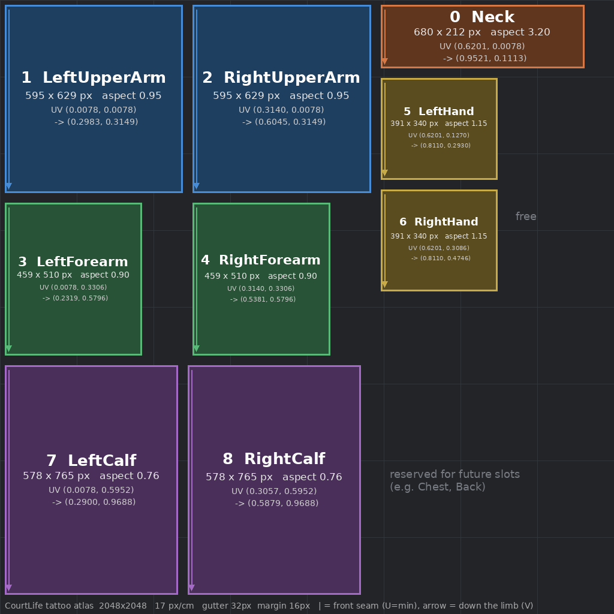

# CourtLife Materials: Skin, Garments, Tattoo Atlas

This guide is for character artists and anyone setting up the project. The parameter names below are **contracts**: the C++ (`Private/CLCustomizationComponent.cpp`) sets them by name. If you rename one, the game silently stops coloring that thing. To change a contract, talk to tech art and the lead programmer first.

> Status: the setup script and the material graphs it builds are **unverified in Unreal**. They were written against the UE 5.x Python API but have not been run in the editor yet. The first person to run it should check the Output Log and report problems.

## 1. Skin master: `M_Skin_Master`

| Parameter | Type | Default | Set by code | Purpose |
|---|---|---|---|---|
| `SkinTone` | Vector | (0.27, 0.09, 0.02) | yes, `Build.Body.SkinTone` | Skin base color (linear) |
| `EyeColor` | Vector | (0.05, 0.02, 0.01) | yes, `Build.Face.EyeColor` | Iris tint |
| `TattooAtlas` | Texture (RGBA) | `T_TattooAtlas_Default` (transparent) | yes, runtime render target | Painted tattoos; **A = coverage** |
| `IsEye` | Scalar 0/1 | 0 | no | Set to 1 on the eye material instance |
| `Roughness` | Scalar | 0.45 | no | Placeholder until the skin detail maps land |

Graph:

```
Inked = lerp(SkinTone, TattooAtlas.RGB, TattooAtlas.A)
Base  = lerp(Inked, EyeColor, IsEye)
```

Rules:

- The code sets `SkinTone`, `EyeColor` and `TattooAtlas` on **every** material slot of the body mesh. So every body slot (body, head, arms, eyes) must use an instance of `M_Skin_Master`, or a material that has the same three parameters.
- The body mesh needs a UV layout where the tattoo regions match the atlas (section 3). The body's tattoo UVs live in **UV channel 0** for now. If the body needs a different channel 0 for skin detail, tell tech art and we will add a `TattooUVChannel` switch.
- The material is flagged *Used with Skeletal Mesh* and *Used with Morph Targets* (`body_heavy`, `body_muscular`).
- Skin shading (subsurface profile, detail normals, MetaHuman skin features) is not built yet. That is the next skin task. The parameter contract above will not change.

## 2. Garment master: `M_Garment_Master`

| Parameter | Type | Default | Set by code | Purpose |
|---|---|---|---|---|
| `ColorMask` | Texture | `T_ColorMask_Default` (solid red) | no, one per garment | Which pixels take which color |
| `Primary` | Vector | white | yes | Main color |
| `Secondary` | Vector | black | yes | Trim and second color |
| `Tertiary` | Vector | white | yes | Accents, logos, piping |
| `Number` | Scalar | 0 | yes, jerseys only | Jersey number 0..99 |
| `Roughness` | Scalar | 0.7 | no | Fabric roughness |

Graph:

```
BaseColor = lerp( lerp(Primary, Secondary, ColorMask.G), Tertiary, ColorMask.B )
```

`Number` is exposed and set by the code, but it does not draw anything yet. It is kept alive in the graph (as `Number x 0` added to roughness) so that it shows up in material instances and the code can find it. The jersey number decal (a digit-atlas material function) is a follow-up task.

Hair and facial hair also go through `Equip()`, and their color arrives as `Primary`. Hair materials therefore need a `Primary` vector param as well. That applies to the groom material too.

### How to author a color mask (character artists)

1. Bake or paint one RGB mask per garment, using the same UVs as the garment.
2. Paint **pure channels only**:
   - **Red (255, 0, 0) = Primary.** This is the main body of the garment. Anything that is not green or blue also falls back to Primary, but paint it red so the mask is easy to read.
   - **Green (0, 255, 0) = Secondary.** Trim, side panels, collar.
   - **Blue (0, 0, 255) = Tertiary.** Piping, logos, small accents.
3. Soft edges are fine. Anti-aliased borders blend the two colors, so keep them to 1 or 2 pixels and avoid wide gradients.
4. Do not bake lighting, folds or AO into the mask. Those go in the normal and AO maps.
5. Export a PNG or TGA at the garment's texture budget (see `BUDGETS.md`), named `T_<Garment>_Mask`.
6. Import into `/Game/Characters/Clothing/<Garment>/`. In the texture editor, set **sRGB = off** and **Compression = Default**. The mask is data, not color, and the master samples it as *Linear Color*.
7. Right-click `M_Garment_Master` > **Create Material Instance**, name it `MI_<Garment>`, and set `ColorMask` to your mask.
8. In `DA_Cosmetics`, add the garment under the correct key (`tank`, `tee`, `sleeved`, `short`, `standard`, `long`, `low`, `mid`, `high`, `ankle`, `crew`, `high`, or one of the accessories). Set the item's `Mesh` and set `Material` to `MI_<Garment>`.
9. Test two colorways. Set Primary, Secondary and Tertiary in the instance to loud colors (red, green, blue) and check every panel picks up the right one.

## 3. Tattoo atlas



- Atlas size: **2048 x 2048** (`DA_Cosmetics.TattooAtlasSize`).
- 9 regions, one per `ECLTattooSlot`, in enum order. Every region uses the same texel density (17 px/cm on the 6'6" reference body), so ink looks equally sharp everywhere. There are 32 px gutters between regions and a 16 px margin at the atlas edge.
- Within a region, **U (horizontal) wraps around the limb**, and the left edge of the region is the **front** of the limb. **V (vertical) runs down the limb**, and the top edge is the joint nearest the torso (collar line, shoulder, elbow, wrist, knee).
- The right side of the atlas is free. It is reserved for future slots such as Chest and Back.
- The source of truth is `Content/Python/courtlife_setup/atlas_layout.py`. A JSON copy is in `tattoo_atlas_layout.json`. The setup script copies these values into `DA_Cosmetics.TattooRegions`, so do not hand-edit the regions in the data asset; they are overwritten on the next run.

| # | Slot | UV min | UV max | Aspect (circumference / length) |
|---|---|---|---|---|
| 0 | Neck | (0.6201, 0.0078) | (0.9521, 0.1113) | 3.20 |
| 1 | LeftUpperArm | (0.0078, 0.0078) | (0.2983, 0.3149) | 0.946 |
| 2 | RightUpperArm | (0.3140, 0.0078) | (0.6045, 0.3149) | 0.946 |
| 3 | LeftForearm | (0.0078, 0.3306) | (0.2319, 0.5796) | 0.90 |
| 4 | RightForearm | (0.3140, 0.3306) | (0.5381, 0.5796) | 0.90 |
| 5 | LeftHand | (0.6201, 0.1270) | (0.8110, 0.2930) | 1.15 |
| 6 | RightHand | (0.6201, 0.3086) | (0.8110, 0.4746) | 1.15 |
| 7 | LeftCalf | (0.0078, 0.5952) | (0.2900, 0.9688) | 0.756 |
| 8 | RightCalf | (0.3057, 0.5952) | (0.5879, 0.9688) | 0.756 |

### UV-ing the body for tattoos (character artists)

1. Cut each limb band with **one vertical seam on the back of the limb**. The inner arm faces the body, so put the seam on the inside of the arm, the back of the calf, and the back of the neck. Unwrap the band into a straight rectangle.
2. The front of the limb goes on the **left edge** of the region and the seam on both edges. The top of the band (nearest the torso) goes at the **top**.
3. Scale each band to fill its region exactly. Leave the gutters empty.
4. Mirror the layout for left and right. Both limbs go into their own regions; do not stack mirrored UVs on top of each other.
5. Check: drop `tattoo_atlas_layout.png` into the `TattooAtlas` slot of a test instance. The labels should read upright, from the front, on every limb.

### How tattoos are painted at runtime (`RepaintTattoos`)

1. `ApplyBuild` creates a dynamic material instance for each body slot and calls `RepaintTattoos(Build.Tattoos, Build.Number)`. While the player edits tattoos, the UI calls `RepaintTattoos` directly because it is cheap.
2. On first use, the code creates an **RGBA8 render target** the size of `TattooAtlasSize`, clamped to 256..4096. Each repaint clears it to **transparent**, so `A = 0` everywhere and the skin shows through.
3. For each tattoo it finds the slot's region and works out the design's size in pixels:
   - design height = region height x 0.33 x `Scale`
   - design width = design height x region width / (region height x `Aspect`). This is why `Aspect` must be the real limb proportion: it keeps a square design square on the body.
   - center: U = region left + `Rotate` x region width (wrap around the limb, 0 = front); V = region top + (0.12 + `Offset` x 0.76) x region height (0 = near the joint, 1 = far end).
4. It draws one of three things:
   - **Text designs** (`script`, `number`) draw the text with `DA_Cosmetics.ScriptFont` in the ink color. An empty `number` uses the jersey number.
   - **Wrap designs** (`bWrapsLimb`: bands, sleeves) tile the stencil across the full region width.
   - **Placed designs** are drawn up to three times, shifted by one region width, so a design that crosses the seam continues on the other side of the limb.
5. It sets the render target as `TattooAtlas` on every skin material instance. The skin material then composites `lerp(SkinTone, Atlas.RGB, Atlas.A)`.
6. Sleeves and other garments render on top of the body, so they hide tattoos under them automatically.

### Authoring tattoo stencils: read this first

The C++ draws a stencil with `Canvas->K2_DrawTexture(..., RenderColor = Ink)` using the default translucent blend. Two things follow from that:

- The color written is `stencil RGB x Ink`, and coverage comes from the **stencil's alpha**. A stencil with no alpha channel draws a solid rectangle, and in the skin material that is a dark box.
- The ONBOARDING contract says "grayscale, R = ink", and `FCLTattooDesign` mentions a G accent channel. The current C++ does not read R as coverage and ignores G and `Accent`.

**Until the code or the contract is updated, author stencils like this:** RGBA PNG, RGB = white (or R = ink, G = accent, B = 0), **A = ink coverage**. Use sRGB off, Compression = *UserInterface2D (RGBA)*, no mips. A stencil that fills R and A identically works under both the current code and the intended contract. This mismatch is raised in the tech art report for the lead programmer. The proposed fix is to draw stencils through a small `M_TattooStamp` material (R = coverage, G = accent tint) with `DrawMaterial`.

## 4. Run the setup script

The script is idempotent, so it is safe to run as often as you like. It does not overwrite existing materials unless you ask it to.

**Before you start:** the CourtLife C++ module must be compiled, because the script needs `UCLCosmeticsCatalog` and `UCLAnimSet`. The **Python Editor Script Plugin** must also be enabled (Edit > Plugins > search "Python" > enable, then restart).

1. Open `CourtLife.uproject` in Unreal Engine 5.6 or later.
2. Run the script in one of three ways:
   - **Menu:** Tools > **CourtLife: Run Project Setup** (added by `Content/Python/init_unreal.py` when the editor starts), or
   - **File:** Tools > **Execute Python Script...** > choose `Content/Python/courtlife_setup/setup_project.py`, or
   - **Console:** at the bottom of the editor, switch the console from `Cmd` to `Python` and enter:
     ```
     import courtlife_setup.setup_project as s; s.run()
     ```
3. Open **Window > Output Log** and filter on `CourtLife`. You should see one line for each folder, texture, material and data asset, then `done`. Lines in red are errors; send them to tech art.
4. Check the result:
   - Folders: `/Game/Maps`, `/Game/Data`, `/Game/Characters/{Body,Hair,Clothing,Tattoos}`, `/Game/Animation/{Jumpshot,Dribble,Locomotion,Defense}`, `/Game/Environments`, `/Game/Materials` (+ `Textures`).
   - `/Game/Materials/M_Garment_Master` and `M_Skin_Master` compile without errors when opened.
   - `/Game/Data/DA_Cosmetics` has 9 `TattooRegions` and `TattooAtlasSize = 2048`.
   - `/Game/Data/DA_AnimSet` exists.
5. Rebuild the master material graphs from scratch (this discards hand edits to the masters; instances are kept):
   ```
   import courtlife_setup.setup_project as s; s.run(rebuild_materials=True)
   ```
6. If you change the atlas layout, edit `atlas_layout.py`, then run `python3 atlas_layout.py` and `python3 test_atlas_layout.py` outside Unreal. That updates the JSON and the preview PNG. Then re-run the setup in Unreal to sync `DA_Cosmetics`.

**What the script does not touch:** catalog entries (hair, clothing, designs, font), material instances, meshes and maps.
